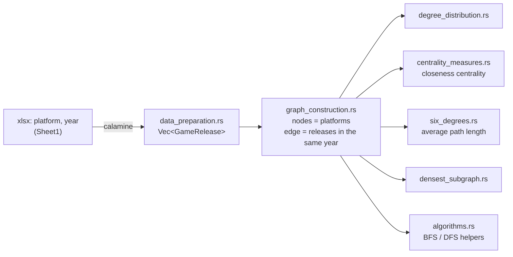

# Game Platform Graph Analysis (Rust)

> **Course project for DS 210 at Boston University (Spring 2024).**

Builds a graph of video-game platforms from release data and analyzes it: degree distribution, closeness centrality, average shortest-path length ("six degrees") and a densest-subgraph search.


## How it works



## Highlights

- **Graph model.** Each platform is a node in a `petgraph::DiGraph`; two platforms are linked when they both have releases in the same year.
- **Shortest-path metrics.** Closeness centrality uses Dijkstra (`petgraph::algo::dijkstra`); the graph-wide average path length uses a hand-written BFS.
- **Densest subgraph, simplified.** Exact search over every subgraph is exponential, so the implementation uses a cheap heuristic: it compares the density after removing one node at a time.
- **Modular crate.** A library (`src/lib.rs`) re-exports each analysis, and `src/main.rs` runs the whole pipeline.

## Tech Stack

Rust (edition 2021) · petgraph 0.6 · calamine 0.24 (xlsx reading)

## Getting Started

```bash
cargo build
cargo test        # 2 unit tests in src/tests.rs
```

The source dataset is Statista's *"Number of major upcoming video games 2022–2024, by platform"* (statistic ID 1391589). It is licensed by Statista and is **not included** in this repository. To run the analysis, put an xlsx file with `platform` (text) and `year` (number) columns in `Sheet1` at:

```text
data/statistic_id1391589_number-of-major-upcoming-video-games-2022-2024-by-platform.xlsx
```

then run `cargo run`.

## Project Structure

```text
src/
├── main.rs                 # end-to-end pipeline
├── lib.rs                  # module declarations and re-exports
├── data_preparation.rs     # xlsx → Vec<GameRelease>
├── graph_construction.rs   # GameGraph (petgraph DiGraph)
├── degree_distribution.rs
├── centrality_measures.rs  # closeness centrality
├── six_degrees.rs          # average path length
├── densest_subgraph.rs     # one-node-removal heuristic
├── algorithms.rs           # BFS / DFS
└── tests.rs
Cargo.toml · Cargo.lock
```

## Results / Learnings

- The crate builds with `cargo build` (dead-code warnings only), and both tests pass, as of this README.
- Building edges for every pair of releases in the same year creates parallel edges. A weighted edge per platform pair would be a cleaner model.
- The densest-subgraph step is a heuristic, not an exact algorithm. Goldberg's max-flow method, or greedy peeling, would be the next step.

## 中文说明

这是 BU DS 210 课程（2024 年春季）的 Rust 期末项目。程序读取各游戏平台的发行数据：每个平台是一个节点，两个平台在同一年都有游戏发行时连一条边。

在这张图上，程序计算：

- 度分布；
- 接近中心性；
- 平均最短路径长度（「六度分隔」）；
- 稠密子图。

稠密子图这一步用的是简化的启发式算法：每次去掉一个节点，比较图的密度，不是精确算法。

原始数据来自 Statista，有版权限制，因此不随仓库公开；运行方法见上方 Getting Started。本次整理从提交历史中恢复了源代码，并把文件移入 `src/`，使项目能够直接编译。
